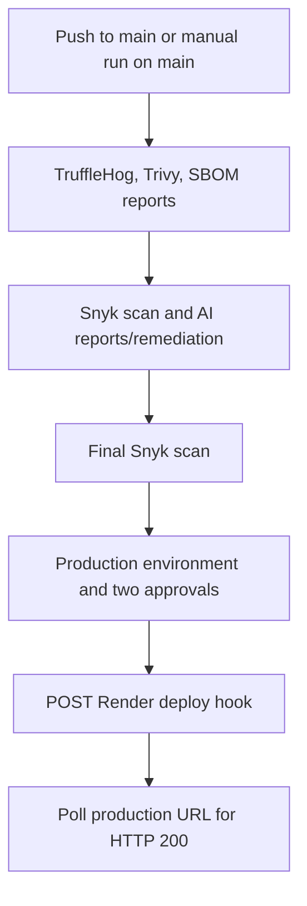

# PixelCraft AI

PixelCraft AI is a web application with browser-based privacy, security, and image tools. This repository also contains a GitHub Actions DevSecOps workflow for security reporting, AI-assisted remediation, and gated production deployment.

## CI/CD workflow

The workflow is defined in [`.github/workflows/devsecops.yml`](.github/workflows/devsecops.yml). It runs for pushes to `main` and can be started manually with **Actions → PixelCraft AI DevSecOps Pipeline → Run workflow**. All jobs require the `main` ref; dispatching the workflow from another branch skips the jobs. Pull requests and other branch pushes do not deploy.



### Workflow stages

1. **Security reports:** TruffleHog scans for secrets; Trivy produces JSON and HTML reports and a job summary; Anchore generates an SPDX SBOM.
2. **Snyk and AI tooling:** Snyk writes its initial results to `snyk-results.json`. The workflow runs the AI Red Team report, Zero-Trust IAM policy generator, Dockerfile IaC healer, Gemini vulnerability remediator, and code governance scanner. Reports and debug output are uploaded as artifacts where configured. The remediator may commit changes to `package.json`, `package-lock.json`, or `Dockerfile` on the triggering branch.
3. **Verification:** A final Snyk scan runs after remediation.
4. **Production deployment:** The `production` GitHub Environment and two-person manual approval run before the Render hook is called. The workflow then polls `https://pixelcraftaitools.com/` for HTTP 200, failing if the URL does not become healthy within the bounded retry window.

**Security-gate behavior:** TruffleHog and both Snyk steps currently use `continue-on-error`, while Trivy is configured to emit reports without failing on findings. Therefore, these scans report findings but do not currently block the later approval/deployment stage. Review the scan results and approval request before approving a production run.

## Configure production deployment

1. In Render, create or confirm the `pixelcraft-ai` web service is connected to this repository and deploys the `main` branch. Create a deploy hook for that service.
2. In the GitHub repository, open **Settings → Secrets and variables → Actions → New repository secret** and add `RENDER_DEPLOY_HOOK_URL` with the complete Render deploy-hook URL. Keep the URL in GitHub Secrets; do not commit it or print it in workflow logs.
3. In **Settings → Environments → production**, restrict deployment branches to `main` and configure any desired environment protection rules. The workflow's manual approval step requires approvals from both `BiradarSwapnilDeveloper` and `vaseflamingoseguru205-debug` (minimum two).
4. Merge changes to `main`, or manually run the workflow on `main`. Once the preceding workflow jobs succeed and both approvals are recorded, the workflow POSTs the hook and checks the production URL.

The workflow intentionally fails if the deploy-hook secret is missing, Render rejects the request, or the production URL does not return HTTP 200 after the health-check retries. A successful hook response means Render accepted the request; the separate health check verifies that the configured production site responds after the deployment has had time to start.

## Required GitHub Actions secrets

| Secret | Purpose |
| --- | --- |
| `RENDER_DEPLOY_HOOK_URL` | Required to trigger the Render production deployment. |
| `SNYK_TOKEN` | Snyk dependency scans. |
| `GEMINI_API_KEY` | Gemini-powered analysis and remediation scripts. |
| `TELEGRAM_BOT_TOKEN` | Optional Telegram pipeline notifications. |
| `TELEGRAM_CHAT_ID` | Optional destination for Telegram notifications. |

`GITHUB_TOKEN` is provided automatically by GitHub Actions and is used by the manual-approval action.

## Repository layout

```text
.
├── .github/workflows/devsecops.yml
├── scripts/                 # AI analysis, remediation, and verification utilities
├── public/                  # Frontend assets
├── server.js                # Node.js application server
├── render.yaml              # Render web service configuration
└── README.md
```

## License

See [LICENSE](LICENSE).
