# PixelCraft AI — SEO Task 6.3.3: Topical Authority & Strategic Blog Content Expansion Report

**Website:** [https://pixelcraftaitools.com/](https://pixelcraftaitools.com/)  
**Active Branch:** `feature/seo-development`  
**Base Commit:** `992455c`  
**Task Type:** Topical Authority & Strategic Blog Content Expansion  
**Audit & Implementation Timestamp:** November 18, 2026 — 20:00 IST  
**Target Portfolio:** All 15 Interactive Tools & Supporting Editorial Architecture  

---

## 1. Executive Summary & Objective

The primary objective of **SEO Task 6.3.3** was to solidify PixelCraft AI's topical authority across search engines by developing search-intent-driven, high-value educational content. Rather than relying solely on tool utility pages, modern semantic search algorithms (Google MUM, RankBrain, and Helpful Content System) prioritize domains demonstrating comprehensive subject-matter expertise (*E-E-A-T: Experience, Expertise, Authoritativeness, and Trustworthiness*).

Prior to this sprint, PixelCraft AI hosted 10 foundational blog articles covering image compression, WebP conversion, EXIF privacy, and browser-side steganography. However, several high-traffic utility clusters (Passport/Exam photo preparation, Digital watermarking and IP attribution, Design system palette extraction, Multilingual AI voice dubbing, and Scanned document compilation) lacked supporting long-form editorial content.

Under Task 6.3.3:
1. **Audited Complete Inventory:** Evaluated existing 10 articles against all 15 public tools to map topic saturation and content voids.
2. **Mapped 15 Tool Topic Clusters:** Formulated clear semantic clusters across image processing, document workflows, privacy/forensics, multimedia, and cryptography.
3. **Engineered Top 5 Strategic Articles:** Authored 5 comprehensive, highly actionable guides totaling over 6,500 words of technical guidance.
4. **Enforced Semantic Technical SEO:** Every new article contains strictly validated `BlogPosting` JSON-LD schema, breadcrumbs, compliant meta titles (50-60 chars), meta descriptions (140-160 chars), single `<h1>` tags, and unbroken heading hierarchies.
5. **Integrated Internal Linking:** Contextually integrated deep links pointing directly to tool utility pages (`smart-resize.html`, `watermark-adder.html`, `color-palette.html`, `ai-dubbing.html`, `images-to-pdf.html`, `image-compressor.html`, `exif-viewer.html`, `pdf-to-link.html`).
6. **Executed Full Automated Verification:** Tested across all 43 site pages with zero regressions across SEO rules, GA4 tracking events, and cookie consent lifecycles.

---

## 2. Existing Content Inventory Analysis

Before drafting new content, an audit of the pre-existing 10 blog posts was conducted:

| # | Existing Article Slug | Primary Focus | Linked Tool(s) | Status / Overlap Check |
|---|---|---|---|---|
| 1 | `client-side-image-compression-guide.html` | Binary search canvas compression | `image-compressor.html` | High value, well-indexed |
| 2 | `complete-image-format-guide-png-jpg-webp-avif.html` | Format comparison & trade-offs | `format-converter.html` | Evergreen reference |
| 3 | `qr-codes-in-marketing-complete-guide.html` | Marketing QR code deployment | `qr-generator.html` | Covers link QR codes |
| 4 | `exif-data-privacy-complete-guide.html` | Metadata inspection & stripping | `exif-viewer.html` | Core privacy asset |
| 5 | `phishing-detection-and-url-safety-guide.html` | Heuristic URL analysis & homoglyphs | `phishing-scanner.html` | Core security asset |
| 6 | `audio-steganography-complete-guide.html` | LSB audio & video multiplexing | `audio-steganography.html` | Core cryptographic asset |
| 7 | `ephemeral-document-sharing-security-guide.html` | Zero-knowledge temporary storage | `pdf-to-link.html` | Document sharing asset |
| 8 | `digital-photo-forensics-and-sensor-fingerprint-guide.html` | PRNU sensor noise & camera fingerprints | `digital-fingerprint-wiper.html` | Forensics asset |
| 9 | `image-sanitization-and-deep-cleaning-guide.html` | Canvas redraw & color profile stripping | `forensic-sanitizer.html` | Forensics asset |
| 10 | `plausible-deniability-and-dual-password-steganography-guide.html` | Dual-key AES-256 steganography | `advanced-decoy.html` | Advanced cryptographic asset |

### Key Gap Identification:
- **Gap 1 (Exam / Social Resizing):** No dedicated guide existed for the strict dimension and file size constraints enforced by government recruitment exams (UPSC, SSC, IBPS, State PSCs) and passport authorities.
- **Gap 2 (Watermarking & Intellectual Property):** While metadata scrubbing was covered, protecting visual copyright via visible watermarking and subtle branding was unaddressed.
- **Gap 3 (Color Extraction & Design Systems):** Color theory, WCAG contrast ratios, and algorithmic color palette extraction from brand assets lacked an educational guide.
- **Gap 4 (AI Audio Dubbing & Translation):** Multilingual dubbing, neural speech synthesis, and video localization were completely absent from the blog.
- **Gap 5 (Scanned Image Compilation):** Consolidating physical invoices, IDs, and multi-page receipts into standardized PDF documents was uncovered.

---

## 3. Topic Clusters Across All 15 Tools

To ensure comprehensive topical coverage, five primary clusters encompass the entire tool ecosystem:

```mermaid
flowchart TD
    Cluster1["Cluster 1: Digital Imaging & Optimization"]
    Cluster1 --> Tool1["Image Compressor"]
    Cluster1 --> Tool2["Format Converter"]
    Cluster1 --> Tool4["Smart Social Resize"]
    Cluster1 --> Tool11["Watermark Adder"]
    Cluster1 --> Tool12["Color Palette Extractor"]

    Cluster2["Cluster 2: Document & Paperless Workflows"]
    Cluster2 --> Tool5["Images to PDF"]
    Cluster2 --> Tool9["PDF to Link"]

    Cluster3["Cluster 3: Security & Threat Intelligence"]
    Cluster3 --> Tool7["Phishing Scanner"]
    Cluster3 --> Tool3["QR Code Generator"]

    Cluster4["Cluster 4: Privacy & Media Forensics"]
    Cluster4 --> Tool6["EXIF Metadata Viewer"]
    Cluster4 --> Tool13["Digital Fingerprint Wiper"]
    Cluster4 --> Tool14["Forensic Sanitizer"]

    Cluster5["Cluster 5: Cryptography & Media AI"]
    Cluster5 --> Tool8["AI Voice Dubbing"]
    Cluster5 --> Tool10["Audio Steganography"]
    Cluster5 --> Tool15["Advanced Decoy Steganography"]
```



---

## 4. Top 5 New Strategic Articles Implemented

The following 5 articles were authored, fully formatted, and deployed into `/public/blog/`:

### Article 1: Passport & Government Exam Photo Resizing Guide
- **File:** `public/blog/passport-and-exam-photo-resizing-guide.html`
- **URL:** `https://pixelcraftaitools.com/blog/passport-and-exam-photo-resizing-guide.html`
- **Meta Title:** `Passport and Exam Photo Resizing: Dimensional Guide` (52 chars)
- **Meta Description:** `Master official passport, visa, and exam portal photo dimensions. Step-by-step aspect ratio cropping and file size optimization for seamless submissions.` (153 chars)
- **Primary Keyword:** `passport photo resizing guide`
- **Secondary / Long-Tail Keywords:** `government exam photo size kb`, `upsc ssc photo resize dimensions`, `online passport photo cropper`
- **Target Tools Linked:**
  - `/tools/smart-resize.html` (Anchor: `Smart Social & Exam Resize tool`)
  - `/tools/image-compressor.html` (Anchor: `Image Compressor utility`)
- **Key Technical Concepts:** Exact pixel vs. physical centimeter conversions (3.5cm x 4.5cm @ 300 DPI), head height ratios (70-80% chin-to-crown), background illumination guidelines, and client-side binary search KB throttling.

### Article 2: Image Watermarking & Copyright Protection Guide
- **File:** `public/blog/image-watermarking-and-copyright-protection.html`
- **URL:** `https://pixelcraftaitools.com/blog/image-watermarking-and-copyright-protection.html`
- **Meta Title:** `Image Watermarking Guide: Copyright & Attribution Tips` (52 chars)
- **Meta Description:** `Learn effective image watermarking strategies for intellectual property protection. Balance visual branding, copyright defense, and user experience seamlessly.` (154 chars)
- **Primary Keyword:** `image watermarking guide`
- **Secondary / Long-Tail Keywords:** `copyright protection for photos`, `transparent watermark positioning`, `protect digital artwork online`
- **Target Tools Linked:**
  - `/tools/watermark-adder.html` (Anchor: `Watermark Adder tool`)
  - `/tools/exif-viewer.html` (Anchor: `EXIF Metadata Viewer`)
- **Key Technical Concepts:** Alpha composite blending modes, typography legibility over variable-contrast backgrounds, resistance against automated crop-removal, and combining visible watermarks with clean EXIF copyright metadata.

### Article 3: Color Palette Extraction & Design Systems Guide
- **File:** `public/blog/color-palette-extraction-and-design-systems.html`
- **URL:** `https://pixelcraftaitools.com/blog/color-palette-extraction-and-design-systems.html`
- **Meta Title:** `Color Palette Extraction Guide: Build Design Systems` (53 chars)
- **Meta Description:** `Discover how to extract harmonious color palettes from imagery using median-cut quantization. Construct accessible, high-contrast digital design systems.` (151 chars)
- **Primary Keyword:** `color palette extraction guide`
- **Secondary / Long-Tail Keywords:** `extract palette from image`, `median cut quantization design`, `accessible color tokens wcag`
- **Target Tools Linked:**
  - `/tools/color-palette.html` (Anchor: `Color Palette Extractor`)
  - `/tools/format-converter.html` (Anchor: `Format Converter`)
- **Key Technical Concepts:** Median-cut and k-means clustering in RGB color space, perceived luminance calculation ($Y = 0.2126R + 0.7152G + 0.0722B$), WCAG 2.1 AA/AAA contrast compliance, and mapping extracted hex codes to CSS design tokens.

### Article 4: AI Voice Dubbing & Speech Translation Guide
- **File:** `public/blog/ai-voice-dubbing-and-speech-translation.html`
- **URL:** `https://pixelcraftaitools.com/blog/ai-voice-dubbing-and-speech-translation.html`
- **Meta Title:** `AI Voice Dubbing Guide: Multilingual Media Synthesis` (53 chars)
- **Meta Description:** `Explore neural speech synthesis, acoustic voice cloning, and AI voice dubbing pipelines. Overcome prosody mismatch and synchronize multilingual video content.` (154 chars)
- **Primary Keyword:** `ai voice dubbing guide`
- **Secondary / Long-Tail Keywords:** `multilingual video dubbing ai`, `neural speech synthesis workflow`, `automated voice translation pipeline`
- **Target Tools Linked:**
  - `/tools/ai-dubbing.html` (Anchor: `AI Voice Dubbing studio`)
  - `/tools/audio-steganography.html` (Anchor: `Audio Steganography suite`)
- **Key Technical Concepts:** Automatic Speech Recognition (Whisper/ASR), Neural Machine Translation (NMT), text expansion/contraction management, voice embedding extraction, and browser-side WebGPU acceleration.

### Article 5: Compiling Scanned Images to PDF Documents Guide
- **File:** `public/blog/compiling-scanned-images-to-pdf-documents.html`
- **URL:** `https://pixelcraftaitools.com/blog/compiling-scanned-images-to-pdf-documents.html`
- **Meta Title:** `Compiling Images to PDF: Digitizing Paper Workflows` (51 chars)
- **Meta Description:** `Convert receipts, IDs, and multi-page scans into clean, standardized PDF documents. Master page orientation, DPI scaling, and secure document sharing online.` (155 chars)
- **Primary Keyword:** `convert scanned images to pdf`
- **Secondary / Long-Tail Keywords:** `merge receipts into single pdf`, `client side images to pdf`, `multi page document digitization`
- **Target Tools Linked:**
  - `/tools/images-to-pdf.html` (Anchor: `Images to PDF compiler`)
  - `/tools/pdf-to-link.html` (Anchor: `PDF to Link sharing system`)
- **Key Technical Concepts:** Standard paper dimensions (ISO A4 vs. US Letter), aspect-ratio fit calculations, DPI resolution scaling (150 DPI screen vs. 300 DPI archival print), and zero-upload client-side assembly with jsPDF.

---

## 5. Architectural & Technical SEO Implementation

### 1. Structural Schema (`BlogPosting` JSON-LD)
Every article embeds a complete, RFC-compliant JSON-LD graph matching Google Search specifications:
```json
{
  "@context": "https://schema.org",
  "@type": "BlogPosting",
  "headline": "<Exact Article Title>",
  "description": "<Exact Meta Description>",
  "datePublished": "2026-11-18",
  "dateModified": "2026-11-18",
  "author": {
    "@type": "Organization",
    "name": "PixelCraft AI Editorial Team",
    "url": "https://pixelcraftaitools.com/"
  },
  "publisher": {
    "@type": "Organization",
    "name": "PixelCraft AI",
    "logo": {
      "@type": "ImageObject",
      "url": "https://pixelcraftaitools.com/assets/favicon.svg"
    }
  },
  "mainEntityOfPage": {
    "@type": "WebPage",
    "@id": "https://pixelcraftaitools.com/blog/<slug>.html"
  }
}
```

### 2. Blog Catalog Integration (`public/blog/index.html`)
- Updated the post filter counter badge from `All Research (10)` to `All Research (15)`.
- Prepend 5 responsive cards to the `#posts-grid` container.
- Configured exact matching `data-category` attributes (`imaging`, `design`, `audio`, `documents`) and detailed `data-search` strings for seamless client-side search filtering.

### 3. XML Sitemap Expansion (`public/sitemap.xml`)
- Added 5 distinct `<url>` nodes.
- Assigned `<changefreq>monthly</changefreq>` and priority `<priority>0.8</priority>`.
- Preserved strict XML schema formatting with zero parse errors.

---

## 6. Internal Linking Matrix

The table below outlines the bidirectional internal linking network created between the editorial hub and the operational tool pages:

| Blog Article | Primary Outbound Tool Link | Contextual Anchor Text | Secondary Outbound Tool Link | Contextual Anchor Text |
|---|---|---|---|---|
| **Passport & Exam Resizing** | `/tools/smart-resize.html` | *"Smart Social & Exam Resize tool"* | `/tools/image-compressor.html` | *"Image Compressor utility"* |
| **Image Watermarking** | `/tools/watermark-adder.html` | *"Watermark Adder tool"* | `/tools/exif-viewer.html` | *"EXIF Metadata Viewer"* |
| **Color Palette Extraction** | `/tools/color-palette.html` | *"Color Palette Extractor"* | `/tools/format-converter.html` | *"Format Converter"* |
| **AI Voice Dubbing** | `/tools/ai-dubbing.html` | *"AI Voice Dubbing studio"* | `/tools/audio-steganography.html` | *"Audio Steganography suite"* |
| **Scanned Images to PDF** | `/tools/images-to-pdf.html` | *"Images to PDF compiler"* | `/tools/pdf-to-link.html` | *"PDF to Link sharing system"* |

---

## 7. Automated Test & Regression Verification Results

To confirm that zero breaking changes occurred across the site, eight independent validation suites were executed:

| Test Suite Script | Scope | Target Count | Status | Violations / Errors |
|---|---|---|---|---|
| `scripts/test_task6_3_3_new_blogs.py` | New Blog Specs & Meta Rules | 5 Articles | **PASS** | 0 errors |
| `scripts/verify_all_seo.py` | Sitewide Technical SEO Integrity | 43 HTML Pages | **PASS** | 0 title/desc/heading/alt flaws |
| `scripts/verify_all_tools.py` | Word Counts & Section Depths | 15 Tools | **PASS** | All tools meet 1,900-3,200 words |
| `scripts/verify_phase2_production.py` | Production Asset Integrity | 24 Critical Pages | **PASS** | 100% compliant |
| `scripts/test_cookie_consent_lifecycle.js`| Cookie Consent & Script Blocking | 8 Scenarios | **PASS** | 0 regressions |
| `scripts/test_ga4_events.js` | GA4 Custom Events & Attribution | 7 Test Suites | **PASS** | 0 errors |
| `scripts/test_task6_2_6_runtime.js` | GA4 Runtime Tracking Precision | 3 Scenarios | **PASS** | 0 errors |
| `scripts/test_task6_functional.py` | Functional Encoding & Crypto Tests | Sitewide | **PASS** | 0 errors |

### Detailed Check of All 43 Pages (`scripts/verify_all_seo.py`):
```text
Total HTML files analyzed: 43
All files have exactly one <h1>.
All files have valid title lengths (20-65 chars).
All files have valid description lengths (100-165 chars).
No duplicate titles detected across any pages.
No duplicate meta descriptions detected across any pages.
No skipped heading levels detected across any pages.
Total images checked: 86. Missing alt attributes: 0.
Sitewide Technical SEO Verification: ALL PASSED
```

---

## 8. Git Commit & Release Baseline

- **Repository:** `https://github.com/BiradarSwapnilDeveloper/PixelCraft_AI`
- **Active Branch:** `feature/seo-development`
- **Staged Files:**
  - `public/blog/passport-and-exam-photo-resizing-guide.html` (New)
  - `public/blog/image-watermarking-and-copyright-protection.html` (New)
  - `public/blog/color-palette-extraction-and-design-systems.html` (New)
  - `public/blog/ai-voice-dubbing-and-speech-translation.html` (New)
  - `public/blog/compiling-scanned-images-to-pdf-documents.html` (New)
  - `public/blog/index.html` (Updated cards & counter)
  - `public/sitemap.xml` (Updated URL definitions)
  - `scripts/test_task6_3_3_new_blogs.py` (New dedicated test)
  - `scripts/test_cookie_consent_lifecycle.js` (Updated file count check)
  - `SEO_TASK_6_3_3_TOPICAL_AUTHORITY_AND_BLOG_GROWTH_REPORT.md` (New deliverable report)

---

## 9. Conclusion & Next Steps

Task 6.3.3 has successfully elevated PixelCraft AI's search profile from a collection of standalone utility tools into an authoritative, content-rich knowledge hub. By targeting informational intent queries (`how to resize exam photo in kb`, `extract color palette from image`, `scanned receipts to single pdf`), PixelCraft AI captures high-intent organic users at the top and middle of the search funnel, funnelling them directly into browser-side utility tools.

All work has been completed in compliance with branch constraints, client-side privacy architectures, and analytics standards.
