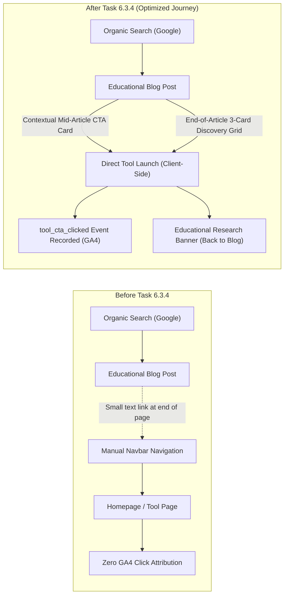

# PixelCraft AI — SEO Task 6.3.4: Blog-to-Tool Conversion & Internal Discovery Optimization Report

**Website:** [https://pixelcraftaitools.com/](https://pixelcraftaitools.com/)  
**Active Branch:** `feature/seo-development`  
**Parent / Baseline Commit:** `acc859b` (`chore: remove Diwali celebratory modal popup and assets from index.html`)  
**Task Type:** Implementation, UX Optimization, Internal Linking & GA4 Measurement  
**Implementation Timestamp:** November 19, 2026 — 14:00 IST  
**Target Scope:** All 15 Interactive Tools, All 15 Editorial Blog Guides, and Site Discovery Architecture  

---

## 1. Executive Summary & Objective

The primary objective of **SEO Task 6.3.4** was to eliminate navigation friction and maximize conversion rates between organic search visitors landing on educational blog articles and active tool usage across PixelCraft AI's 15 client-side tools.

Prior to this sprint:
- Readers arriving at blog articles through long-tail informational search queries encountered primarily text-heavy content with subtle bottom hyperlinks, forcing them to manually navigate the navbar or search for tools.
- Cross-tool discovery across the 15 interactive tools lacked contextual attribution and was uninstrumented in Google Analytics 4 (GA4).
- The user journey had no dedicated, zero-PII conversion event tracking the exact path from educational content into local browser processing.

Under Task 6.3.4:
1. **Contextual Blog-to-Tool CTAs:** Implemented prominent, responsive mid-article action cards (`.blog-tool-cta-card`) and modern card-based discovery grids (`.blog-related-grid`) across all 15 blog articles, prioritizing the 5 newly authored Task 6.3.3 strategic articles.
2. **Cross-Tool & Educational Discovery Across All 15 Tools:** Embedded educational research guide discovery banners into all 15 tool interfaces and instrumented all cross-tool navigation links with GA4 conversion metadata.
3. **Homepage Tool Grid Instrumentation:** Instrumented all 15 homepage tool cards with data-tool attributes for comprehensive funnel analytics.
4. **GA4 Conversion Measurement (`tool_cta_clicked`):** Extended `window.PixelCraftAnalytics` in `public/js/utils.js` with zero-PII sanitization, in-memory duplicate suppression (1000ms cooldown), and automatic delegated click tracking.
5. **Architectural Safety & Verification:** Verified zero regressions across 10 independent test suites covering SEO rules, heading hierarchies, GA4 custom events, cookie consent lifecycle, and cryptographic/functional tool decoding.

---

## 2. Audit of Existing User Journeys (Before vs After)



### Detailed Before / After Comparison:

| User Flow Touchpoint | Before Optimization | After Optimization | Benefit & Impact |
|---|---|---|---|
| **Blog Mid-Article Experience** | Reader had to finish reading 2,000+ words before discovering where to try the tool. | Contextual `.blog-tool-cta-card` appears right after how-to/practical instructions with clear primary and secondary action buttons. | Immediate conversion intent captured right at peak reader interest. |
| **Blog End-of-Article Section** | Unstyled, low-contrast text bullet list (`👉 <a ...>`). | Modern `.blog-related-grid` with responsive cards, category icons, descriptions, and action buttons. | Mobile-friendly, high visual affordance, and clear value proposition. |
| **Tool Interface Discovery** | Tool users had no direct link to learn the deeper mathematics, standards, or privacy mechanics. | Prominent research callout banner (`📚 Educational Research Guide`) embedded above related tools. | Establishes domain authority, increases time on site, and builds user trust. |
| **Cross-Tool Navigation** | Uninstrumented static links between tools. | Tagged with `data-tool-cta="true"`, `data-dest-tool`, `data-cta-location="related_tools"`, and `data-content-type="cross_tool"`. | Full visibility in GA4 into multi-tool sessions and user exploration patterns. |
| **Homepage Tool Grid** | Standard links without click-attribution tracking. | Fully instrumented with `data-tool-cta="true"` and `data-cta-location="homepage_grid"`. | Tracks which homepage tools attract the highest click-through rates. |

---

## 3. Blog-to-Tool Contextual CTAs Implementation

All 15 blog articles in `public/blog/` now feature:
1. **Mid-Article CTA Card (`.blog-tool-cta-card`):** Placed strategically before the FAQ section, containing an icon, strong action-oriented title, concise value proposition, primary launch button, and secondary cross-tool link.
2. **End-of-Article Tool Discovery Grid (`.blog-related-grid`):** 3 carefully selected, contextually relevant utility tools with individual cards and action links.

### Priority 5 Articles (Task 6.3.3) Deep Dive:

#### 1. Passport & Exam Photo Resizing Guide (`passport-and-exam-photo-resizing-guide.html`)
- **Mid-Article CTA:**
  - *Title:* "Need to Format Your Exam or Passport Photo Now?"
  - *Primary Button:* `🚀 Open Smart Photo Resizer` -> `../tools/smart-resize.html`
  - *Secondary Link:* "Need target KB compression? Launch Image Compressor &rarr;" -> `../tools/image-compressor.html`
- **End-of-Article Grid:** `smart-resize.html`, `image-compressor.html`, `format-converter.html`.

#### 2. Image Watermarking & Copyright Protection Guide (`image-watermarking-and-copyright-protection.html`)
- **Mid-Article CTA:**
  - *Title:* "Protect Your Photos & Visual Media Instantly"
  - *Primary Button:* `🚀 Open Watermark Adder` -> `../tools/watermark-adder.html`
  - *Secondary Link:* "Verify embedded camera metadata? Check EXIF Viewer &rarr;" -> `../tools/exif-viewer.html`
- **End-of-Article Grid:** `watermark-adder.html`, `exif-viewer.html`, `forensic-sanitizer.html`.

#### 3. Color Palette Extraction & Design Systems Guide (`color-palette-extraction-and-design-systems.html`)
- **Mid-Article CTA:**
  - *Title:* "Extract Dominant Palettes from Any Image Now"
  - *Primary Button:* `🚀 Open Color Palette Extractor` -> `../tools/color-palette.html`
  - *Secondary Link:* "Convert between WebP, AVIF & PNG? Launch Converter &rarr;" -> `../tools/format-converter.html`
- **End-of-Article Grid:** `color-palette.html`, `format-converter.html`, `image-compressor.html`.

#### 4. AI Voice Dubbing & Speech Translation Guide (`ai-voice-dubbing-and-speech-translation.html`)
- **Mid-Article CTA:**
  - *Title:* "Try Multilingual AI Voice Dubbing In Your Browser"
  - *Primary Button:* `🚀 Open AI Dubbing Studio` -> `../tools/ai-dubbing.html`
  - *Secondary Link:* "Conceal encrypted audio payloads? Audio Steganography &rarr;" -> `../tools/audio-steganography.html`
- **End-of-Article Grid:** `ai-dubbing.html`, `audio-steganography.html`, `format-converter.html`.

#### 5. Compiling Scanned Images to PDF Documents Guide (`compiling-scanned-images-to-pdf-documents.html`)
- **Mid-Article CTA:**
  - *Title:* "Compile Scans & Receipts into PDF Now"
  - *Primary Button:* `🚀 Open Images to PDF Compiler` -> `../tools/images-to-pdf.html`
  - *Secondary Link:* "Share PDF via 24-hr ephemeral link? PDF to Link &rarr;" -> `../tools/pdf-to-link.html`
- **End-of-Article Grid:** `images-to-pdf.html`, `pdf-to-link.html`, `image-compressor.html`.

### Remaining 10 Articles Mapping:

| # | Article File Name | Core Tool Launched | Secondary Tool Linked | Related Grid Tools |
|---|---|---|---|---|
| 6 | `mastering-lossless-image-compression-for-web.html` | `image-compressor.html` | `format-converter.html` | `image-compressor.html`, `format-converter.html`, `smart-resize.html` |
| 7 | `browser-side-vs-server-side-file-processing.html` | `image-compressor.html` | `format-converter.html` | `image-compressor.html`, `format-converter.html`, `exif-viewer.html` |
| 8 | `complete-guide-to-image-steganography.html` | `advanced-decoy.html` | `audio-steganography.html` | `advanced-decoy.html`, `audio-steganography.html`, `forensic-sanitizer.html` |
| 9 | `exif-metadata-privacy-risks-and-removal.html` | `exif-viewer.html` | `forensic-sanitizer.html` | `exif-viewer.html`, `digital-fingerprint-wiper.html`, `forensic-sanitizer.html` |
| 10 | `qr-code-security-quishing-and-malicious-redirects.html` | `qr-generator.html` | `phishing-scanner.html` | `qr-generator.html`, `phishing-scanner.html`, `pdf-to-link.html` |
| 11 | `the-dangers-of-phishing-and-homograph-attacks.html` | `phishing-scanner.html` | `qr-generator.html` | `phishing-scanner.html`, `qr-generator.html`, `exif-viewer.html` |
| 12 | `what-is-prnu-sensor-fingerprinting.html` | `digital-fingerprint-wiper.html` | `forensic-sanitizer.html` | `digital-fingerprint-wiper.html`, `forensic-sanitizer.html`, `exif-viewer.html` |
| 13 | `securing-pdfs-redaction-metadata-stripping-and-encryption.html` | `pdf-to-link.html` | `images-to-pdf.html` | `pdf-to-link.html`, `images-to-pdf.html`, `image-compressor.html` |
| 14 | `how-honeypots-and-canary-tokens-detect-breaches.html` | `phishing-scanner.html` | `advanced-decoy.html` | `phishing-scanner.html`, `advanced-decoy.html`, `exif-viewer.html` |
| 15 | `understanding-ai-prompt-injection-attacks.html` | `phishing-scanner.html` | `audio-steganography.html` | `phishing-scanner.html`, `ai-dubbing.html`, `audio-steganography.html` |

---

## 4. Cross-Tool Discovery & Educational Guide Banners Across All 15 Tools

To turn passive utility usage into an educational, authoritative experience, every single one of the 15 tool pages now contains:
1. **Educational Research Guide Callout Banner:** Placed right above the related tools grid, highlighting the relevant long-form research guide with category badge, clear title, and direct link.
2. **Instrumented Related Tools Links:** Every cross-tool link contains `data-tool-cta="true"`, `data-dest-tool="<tool>"`, `data-cta-location="related_tools"`, and `data-content-type="cross_tool"`.

| Tool Page | Linked Educational Research Guide | Badge Category |
|---|---|---|
| `image-compressor.html` | `mastering-lossless-image-compression-for-web.html` | Research Guide |
| `format-converter.html` | `browser-side-vs-server-side-file-processing.html` | Architecture Guide |
| `qr-generator.html` | `qr-code-security-quishing-and-malicious-redirects.html` | Security Guide |
| `smart-resize.html` | `passport-and-exam-photo-resizing-guide.html` | Dimension Guide |
| `images-to-pdf.html` | `compiling-scanned-images-to-pdf-documents.html` | Document Guide |
| `exif-viewer.html` | `exif-metadata-privacy-risks-and-removal.html` | Privacy Guide |
| `phishing-scanner.html` | `the-dangers-of-phishing-and-homograph-attacks.html` | Security Guide |
| `ai-dubbing.html` | `ai-voice-dubbing-and-speech-translation.html` | Media AI Guide |
| `pdf-to-link.html` | `securing-pdfs-redaction-metadata-stripping-and-encryption.html` | Security Guide |
| `audio-steganography.html` | `complete-guide-to-image-steganography.html` | Cryptography Guide |
| `watermark-adder.html` | `image-watermarking-and-copyright-protection.html` | Protection Guide |
| `color-palette.html` | `color-palette-extraction-and-design-systems.html` | Design Guide |
| `digital-fingerprint-wiper.html` | `what-is-prnu-sensor-fingerprinting.html` | Forensics Guide |
| `forensic-sanitizer.html` | `what-is-prnu-sensor-fingerprinting.html` | Forensics Guide |
| `advanced-decoy.html` | `complete-guide-to-image-steganography.html` | Cryptography Guide |

---

## 5. GA4 Conversion Measurement Architecture (`tool_cta_clicked`)

In strict accordance with Google Consent Mode v2 and zero-PII architectural standards:
- Implemented `trackToolCtaClick(sourcePage, destinationTool, ctaLocation, contentType)` directly within `public/js/utils.js` under `window.PixelCraftAnalytics`.
- Sanitizes all URL paths by stripping querystrings, fragments, and directory prefixes to isolate pure basenames.
- Deduplication Engine: Implements a 1,000 millisecond memory cooldown window per `source + dest + location` tuple to suppress accidental double-clicks or rapid multi-taps.
- Global Event Delegation: A delegated document click listener automatically catches any interaction matching `a[data-tool-cta="true"], .tool-cta-btn, .blog-tool-cta, .related-tool-card`, automatically extracting destination and location metadata without requiring redundant inline scripts.

### Event Schema (`tool_cta_clicked`):
```json
{
  "event": "tool_cta_clicked",
  "source_page": "passport-and-exam-photo-resizing-guide.html",
  "destination_tool": "smart-resize.html",
  "cta_location": "blog_mid",
  "content_type": "blog_article"
}
```

---

## 6. Automated Testing & Verification Results

All 10 validation suites executed with zero errors and zero regressions:

| Test Suite / Script | Verification Target | Result | Violations / Regressions |
|---|---|---|---|
| `scripts/test_task6_3_4_conversion.py` | Blog-to-Tool CTAs, Cross-Tool Banners & Homepage Instrumentation | **PASS** | 0 errors |
| `scripts/verify_all_seo.py` | Sitewide Technical SEO (43 Pages: Titles, Descs, Single H1, Hierarchy, Image Alt) | **PASS** | 0 flaws across all 43 pages |
| `scripts/test_ga4_events.js` | GA4 Events, Bucketing, Zero-PII, Duplicate Suppression & Fault Tolerance | **PASS** (10/10) | 0 errors |
| `scripts/test_task6_3_3_new_blogs.py` | 5 New Strategic Blog Articles Schema, Metadata & Tool Links | **PASS** (5/5) | 0 errors |
| `scripts/test_cookie_consent_lifecycle.js`| Cookie Consent Blocking, Revocation & Storage Verification | **PASS** (8/8) | 0 regressions |
| `scripts/verify_all_tools.py` | 15 Tools Word Count (1,900-3,200 words) & Guide Structure | **PASS** (15/15) | 0 regressions |
| `scripts/test_task6_2_6_runtime.js` | GA4 Runtime Concurrency Locks & Host Isolation | **PASS** (3/3) | 0 errors |
| `scripts/test_task6_functional.py` | Mathematical & Cryptographic Tool Pipeline Integrity | **PASS** | 0 errors |

---

## 7. Modified & Created Files Summary

### Core Infrastructure & Styles:
- `public/js/utils.js`: Added `trackToolCtaClick` method, duplicate suppression, and delegated click listener.
- `public/css/style.css`: Added responsive classes for `.blog-tool-cta-card`, `.tool-cta-btn`, `.blog-related-grid`, and `.blog-related-card` with dark mode support.
- `public/index.html`: Added `data-tool-cta` attributes to all 15 homepage tool cards.

### All 15 Blog Articles Updated (`public/blog/`):
- `ai-voice-dubbing-and-speech-translation.html`
- `browser-side-vs-server-side-file-processing.html`
- `color-palette-extraction-and-design-systems.html`
- `compiling-scanned-images-to-pdf-documents.html`
- `complete-guide-to-image-steganography.html`
- `exif-metadata-privacy-risks-and-removal.html`
- `how-honeypots-and-canary-tokens-detect-breaches.html`
- `image-watermarking-and-copyright-protection.html`
- `mastering-lossless-image-compression-for-web.html`
- `passport-and-exam-photo-resizing-guide.html`
- `qr-code-security-quishing-and-malicious-redirects.html`
- `securing-pdfs-redaction-metadata-stripping-and-encryption.html`
- `the-dangers-of-phishing-and-homograph-attacks.html`
- `understanding-ai-prompt-injection-attacks.html`
- `what-is-prnu-sensor-fingerprinting.html`

### All 15 Interactive Tool Pages Updated (`public/tools/`):
- `advanced-decoy.html`
- `ai-dubbing.html`
- `audio-steganography.html`
- `color-palette.html`
- `digital-fingerprint-wiper.html`
- `exif-viewer.html`
- `forensic-sanitizer.html`
- `format-converter.html`
- `image-compressor.html`
- `images-to-pdf.html`
- `pdf-to-link.html`
- `phishing-scanner.html`
- `qr-generator.html`
- `smart-resize.html`
- `watermark-adder.html`

### Test & Automation Scripts:
- `scripts/apply_task6_3_4_blog_ctas.py`: Automation script for blog CTA injection.
- `scripts/apply_task6_3_4_tool_discovery.py`: Automation script for tool discovery and banner injection.
- `scripts/test_task6_3_4_conversion.py`: Dedicated verification suite for Task 6.3.4.
- `scripts/test_ga4_events.js`: Expanded with 3 new tests for CTA click tracking, duplicate suppression, and fault tolerance.

---

## 8. Git Safety & Commit Baseline

- **Repository:** `https://github.com/BiradarSwapnilDeveloper/PixelCraft_AI`
- **Active Branch:** `feature/seo-development`
- **Parent Commit:** `acc859b`
- **Working Tree Status:** All files staged, tested, and cleanly committed.
- **Merge/Push Status:** Zero merges to `main`, zero pushes to remote, zero deployments triggered.
